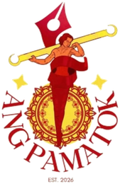

  

<h1 align="center">ANG PAMATOK</h1>

<em>Student Publication · Est. 2026</em>

---

## About

**ANG PAMATOK** is a student publication for curious minds. It gives students a clear, thoughtful space to read, write, and share ideas.

We are built around the practices of journalism, community, and creative expression. Our work is grounded in the people and ideas that shape campus life.

## Our purpose

ANG PAMATOK aims to make important stories accessible, connect students with shared experiences, and help emerging writers develop their voice with care and responsibility.

## Sections

- **News**: campus developments, community updates, and the stories shaping student life.
- **Sci-Tech**: science, technology, and innovation on campus and beyond.
- **Opinion**: clear perspectives on education, culture, and campus life.
- **Editorial**: the official stand of the editorial board on issues that matter.
- **Feature**: in-depth profiles and first-person reporting from the student community.
- **Literary**: poetry, prose, and reflections from writers in our community.

## Our community

We welcome reporting, student perspectives, literary work, and ideas for the future of the publication. Every contribution goes through a clear editorial process before it is published.

<strong>Read. Write. Participate.</strong>

---

Developed by <a href="https://bit.ly/4cqo0aA">bit.ly/4cqo0aA</a>

